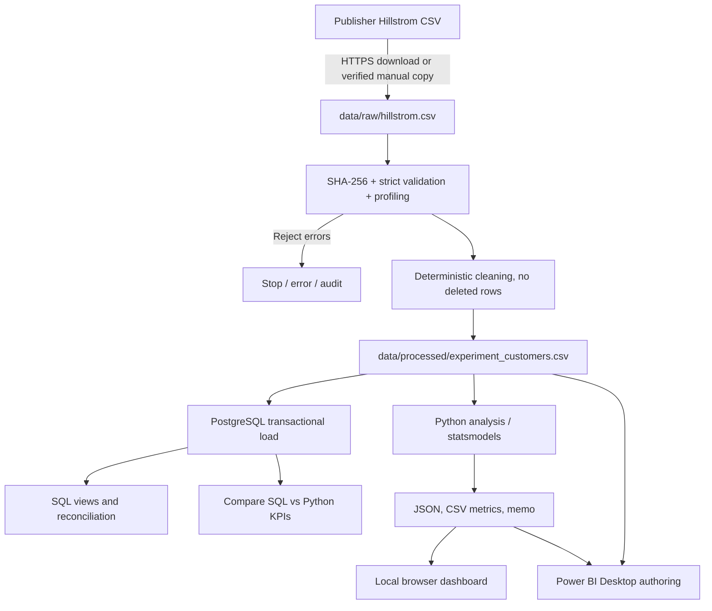

# Architecture & trust boundary

Design principles: raw source bytes immutable; generated `source_row_number` is **not** a real customer ID. Configuration via environment variables only. No database password in Git. All data-changing database operations are atomic. Primary inference is carried out by Python and is not re-estimated inside Power BI slicers.

**Trust boundaries:** Raw dataset is publicly described by its original author, but the license is unspecified. External sources should be treated as untrusted. The database is only bound to local host in Compose. No remote dashboard analytics and no external JavaScript CDN.
