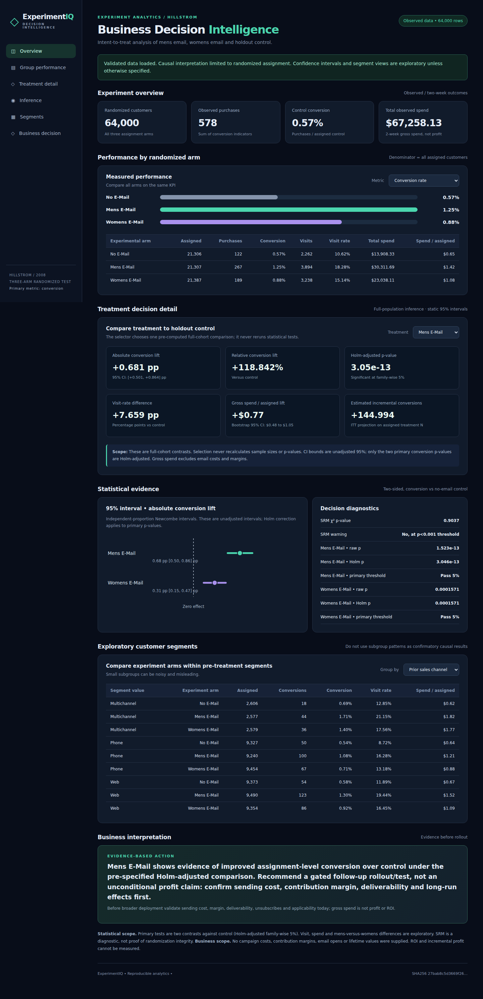

# ExperimentIQ — Portfolio demonstration

**Positioning:** A/B Testing, SQL Analytics, Statistical Inference and Business Decision Intelligence — a reproducible real-historical experimental analysis, **not** a deployed marketing system or claim of ROI.

## A 4-minute recruiter demonstration

1. Open the [verified dashboard source](../dashboard/index.html) locally via `python -m http.server 8000 -d dashboard`. The data comes from the published mirror-derived actual report JSON, **not** the synthetic `?demo=1` route.
2. Highlight 64,000 randomized assignments and the all-assigned denominators: No E-Mail 21,306 assigned / 122 conversions; Mens 21,307 / 267; Womens 21,387 / 189.
3. Choose Mens then Womens in the **Treatment decision detail** control. Men vs control: +0.6805 pp (Newcombe unadjusted 95% CI [0.5014,0.8641] pp), Holm p=3.05×10⁻¹³. Women vs control: +0.3111 pp, CI [0.1502,0.4745] pp, Holm p=0.000157. The selector switches stored full-sample inference; it does not make an invalid filtered p-value.
4. Show [PostgreSQL views](../sql/002_views.sql), [audited statistical engine](../src/experimentiq/stats.py), [verified memo](../reports/business_decision_memo_actual.md) and [independent tests](../tests/test_published_integrity.py). Explain 43-test GitHub CI, database parity and historical-experiment caveats.
5. Show gross-spend/customer differences: Mens +$0.7698, Womens +$0.4244 versus control. These are randomized sample contrasts, **not** verified incremental profit or ROI. Recommend only a gated modern follow-up after validating sending cost, margin, delivery and unsubscribe rates.

## Rebuild Power BI on Windows

[Download the complete deterministic aggregate-only ZIP](../powerbi/ExperimentIQ-PowerBI-Rebuild.zip), extract it, then follow [Windows Power BI Desktop authoring blueprint](../powerbi/desktop/VISUAL_BLUEPRINT.md). There are four separate typed M queries, DAX definitions and four prescribed pages. Do not rename the ZIP to PBIX. No Power BI Desktop visual validation has been performed here, so a finished PBIX is NOT part of this release.

## Audit and limits

Source: third-party public Hillstrom mirror, exact SHA256 `27bab8c5d3669f26ec08ebb50a0a78317542f29501156f2e2af6781fab4cd7e2`. Original publisher file checksum not available, so mirror fidelity cannot be cryptographically certified. The 2008 experiment has a two-week outcome horizon. Assignment-to-email is randomized, but delivery, opens, sending cost, margin, unsubscribe and modern-market generalizability cannot be tested using this dataset. Synthetic demo data lives separately and is marked synthetic.

**A truthful CV bullet:** *Built an auditable A/B-testing analytics platform on 64,000 historical randomized marketing records with Python, PostgreSQL, statsmodels and browser-based BI; independently verified 2 Holm-adjusted treatment/control contrasts, SQL/Python KPI parity, 43 GitHub CI tests and gated rollout recommendations.*
